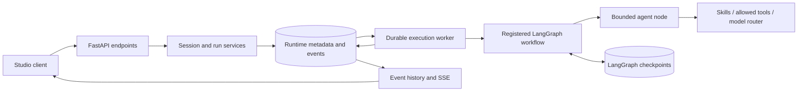

# Agent Service Architecture

## Responsibility and status

Agent owns research orchestration and the custom chat runtime. LangGraph owns
workflow execution, state, checkpoints, interrupts, and resume. Bounded agents
operate inside graph nodes.

| Capability | Status |
| --- | --- |
| Assistants, sessions, persisted runs, cancellation and recovery | Implemented |
| Durable inspection events and checkpoint queries | Implemented |
| Graph registry, skill registry, tool policies and model-tier routing | Implemented |
| Skill-driven `echo` workflow | Implemented |
| Company research, screening, industry research and comparison | Planned |
| Quantitative API and Knowledge retrieval integration | Planned |
| Reusable research-artifact archive | Planned |

## Runtime flow

An accepted request persists before execution. A session UUID maps to the
LangGraph thread identifier; each turn has a separate run identifier. The
checkpoint store provides conversation continuity. SSE observes durable events;
disconnecting does not cancel the accepted run.

Application lifespan creates database resources, registries, graphs, and the
worker. Graph factories receive shared `GraphResources` and compile with the
checkpointer. Graph imports do not construct model clients or compile workflows.

## State, skills, and tools

The implemented echo workflow adapts messages into an explicit skill request
and maps the response back into graph state. Research workflows will use a
stable typed `ResearchState`, with skill-specific temporary data under
`skill_state`. That research contract is planned, rather than an implemented
company-research graph.

Skills describe methodology and required tools. Nodes own state adapters;
skills do not mutate graph state. Effective tools are the intersection of skill
requirements, agent policy, and registered tools. Model tiers select configured
provider/model routes instead of hard-coding providers in graph nodes.

## Persistence and replay

| Store | Owner | Content |
| --- | --- | --- |
| `runtime` schema | Custom FastAPI application | Assistants, sessions, runs, pending requests and inspection events |
| `checkpoints` schema | LangGraph PostgreSQL checkpointer | Messages, workflow state, checkpoints and interrupts |
| Research-artifact archive | Planned research domain | Completed analyses, source references and provenance |

Runtime metadata does not duplicate checkpoint-owned conversation state.
An advisory lock permits one execution owner per database. Pending runs survive
restart; interrupted execution recovery requires explicit acknowledgement.
Cancellation is cooperative. Nodes may replay, so human review should remain
small and side effects must be idempotent or use idempotency keys.

## Service boundaries

Knowledge owns document processing and retrieval. Quantitative data remains in
the separate Stocker project. Planned research graphs consume those services
through public contracts and tools. They do not import Knowledge internals or
move document ETL into the runtime.

The first planned research flow is company research with cyclical-bottom signals,
qualitative evidence, synthesis, and a reusable artifact. Deterministic Python
handles financial calculations; model tasks handle qualitative evidence and
contradictions. Automated order execution is outside the initial product scope.

Studio provides development inspection. The [planned Chat client](../chat/architecture.md)
provides a separate user-facing entry point; neither frontend owns execution or
persistence. See [backend operations](backend.md) and
[Knowledge architecture](../knowledge/architecture.md).
