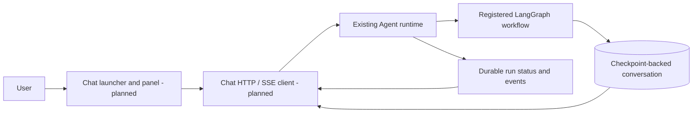

# Chat Bubble Architecture

## Responsibility and status

Chat is the planned user-facing conversation entry point for Stocker research.
The intended interface is a frontend chat bubble that can open a conversation
panel. No launcher, standalone application, embedding package, or Chat runtime
integration is implemented. `chat/` is a documentation placeholder.

Studio's existing conversation view renders messages and run controls for
development. A reusable user-facing widget has not been extracted from it.

## Target flow

## Client and service ownership

| Component | Responsibility |
| --- | --- |
| Chat launcher and panel | Planned open/close behavior, messages, composer and user feedback |
| Chat transport | Planned session continuity, idempotent requests and event reconnect |
| Agent | Existing assistants, sessions, execution, interrupts, recovery and checkpoints |
| Knowledge | Planned evidence retrieval consumed through Agent tools |

Chat does not run graphs, keep model keys, or own conversation persistence.
Panel visibility is local UI state. Conversation continuity uses the same
Agent session across HTTP requests. A dismissed panel or disconnected SSE stream
does not imply cancellation of accepted work.

## Conversation behavior

The planned UI should distinguish accepted, running, completed, interrupted,
failed, and recovery-required work. It should read saved messages from state,
use a unique idempotency key for each new submission, and acknowledge replay
before recovery. Human review maps to LangGraph interrupt/resume.

Current Agent events provide durable execution observation. Per-token streaming
and AG-UI integration remain future options; neither is required by the existing
HTTP contract. Research answers and source citations depend on research workflows
and artifact capabilities that are also planned.

## Delivery decisions

Framework, embedding mechanism, styling isolation, hosting, authentication,
session authorization, and browser-storage policy remain undecided. The reserved
location is `chat/`, separate from Studio and Dashboard, with its own future
frontend dependencies. This documentation does not introduce a root pnpm workspace.

See [backend integration status](backend.md), [Chat placeholder](../../chat/README.md),
and [Studio architecture](../studio/architecture.md).
