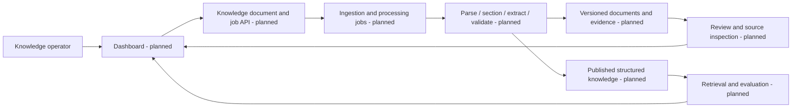

# Knowledge Dashboard Architecture

## Responsibility and status

Dashboard is the planned operator UI for Knowledge document processing and
retrieval. It will cover imports, processing progress, extraction review,
source evidence, and retrieval evaluation. No frontend is implemented yet.

Knowledge's HTTP foundation and model adapters exist. The document pipeline,
persistence, jobs, retrieval, and MCP shown below are planned.

## Target flow

## Ownership boundaries

| Component | Owns |
| --- | --- |
| Dashboard | Planned operator views, inputs, and presentation of backend status |
| Knowledge | Document processing, evidence, validation, publication, and retrieval |
| Studio | Implemented Agent execution and checkpoint inspection |
| Chat | Planned user-facing research conversation |

Dashboard calls public Knowledge contracts. Knowledge owns long-running jobs
and durable processing records; UI connection state does not determine job
completion. Research conclusions and Agent conversations stay with Agent.

## Evidence and review

Planned review views should preserve document identity, page, section, supporting
text, confidence, and extractor version. Source claims and forecasts retain
attribution; the UI must not present extraction as proof that a claim is true.
Published knowledge and pending review should be distinguishable.

Retrieval should prefer structured records, then document sections, then
semantic search. Processing and publication state must make incomplete or stale
results visible. Detailed data contracts remain part of the Knowledge design.

## Application boundary

The reserved application location is `dashboard/`, with its own future manifest,
lockfile, and dependencies. Framework, routes, ports, hosting, and authentication
remain undecided. This document introduces no runnable UI or new backend.

See [backend integration status](backend.md) and
[Knowledge architecture](../knowledge/architecture.md).
