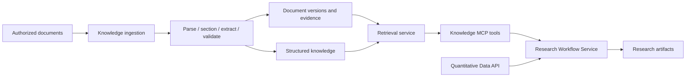

# Knowledge Service Architecture

## Responsibility and status

Stocker uses separate quantitative data, qualitative knowledge, and research
workflow services. The `knowledge/` project owns the qualitative knowledge service.

| Service | Owns | Consumes |
| --- | --- | --- |
| Quantitative Data | Crawlers, financial/revenue/price ETL and APIs | Its quantitative sources |
| Knowledge | Document ETL, source evidence, structured knowledge and retrieval | Authorized documents and optional external entity identifiers |
| Research Workflow | Research graphs, skills, quantitative calculations, synthesis and research artifacts | Quantitative APIs and Knowledge MCP tools |

The service HTTP foundation and lazy model-provider adapters are implemented.
All ingestion, knowledge, retrieval, persistence, MCP, and external integration
components below are target architecture, not implemented capabilities.



Knowledge does not host the Agent chat runtime, select stocks, produce investment
conclusions, or persist the Agent's research artifacts. Source-authored forecasts
and analyst views may be stored with attribution; extraction does not establish
that a statement is true.

## Repository adaptation

The application lives in `knowledge/src/knowledge/`, is imported as `knowledge`, and is
packaged as `stocker-knowledge`. Python configuration, the lockfile and tests
live in the `knowledge/` service directory. Reusable configuration and provider code are retained.
Copied Agent graphs, agent factories, research skills/tool registries, session/run
APIs, runtime SQL, checkpoint startup, and frontend manifests are removed from
the application source and active development commands. Knowledge tests cover service boundaries and providers; Agent tests remain in `agent/tests/`.

The backend does not load configuration from the old application directory.
Existing local credentials and generated artifacts are not migrated automatically;
operators provide the Knowledge Service's settings separately.

The backend uses the `server.py` → `app/core/factory.py` assembly pattern.
HTTP handlers live in `app/routers/` and their public schemas in `app/models/`.
Configuration and model providers remain sibling packages. `dashboard/` is the
Knowledge UI location, separate from Agent Studio in `studio/`. It has
a documentation placeholder and will manage its own frontend dependencies.

The following target layout uses those conventions. Only `app/core/`,
`app/routers/`, `app/models/`, `config/`, `llm/` and `server.py` are implemented;
introduce the other modules with their capabilities:

```text
knowledge/src/knowledge/
  app/
    core/                  Application factory and resource lifecycle
    dependencies/          FastAPI dependency accessors
    routers/               HTTP transport
    models/                Public HTTP contracts
    services/              Application use cases shared by HTTP and MCP
    database/              Database resources and migration execution
    migrations/            Service-owned migration files
    repositories/          Persistence queries
    utils/                 Transport serialization and other shared helpers
  config/                  Service configuration
  llm/                     Provider-neutral model access
  document_pipeline/       Parsing, sectioning, extraction and validation
  graphs/document_pipeline/ Typed LangGraph orchestration, when introduced
  models/                  Transport-independent document and knowledge contracts
  retrieval/               Structured, section and semantic retrieval
  mcp/                     Consumer tool transport
  server.py                FastAPI entrypoint
```

HTTP and MCP must call the same application services. Domain and retrieval code
must not depend on HTTP handlers, MCP transport, or the consumer's ResearchState.
LangGraph remains the intended document-workflow orchestration layer; the chat
runtime is not a prerequisite for running a document graph. Agents, if needed,
work inside bounded extraction nodes rather than controlling the whole service.

## Processing and persistence boundaries

The intended processing flow is import → parsing → section detection → targeted
extraction → validation / review → publication → optional indexing. Synchronous
queries only read published data; long-running work uses independently observable
jobs. Stage artifacts, source versions, and extractor versions support retries and
reprocessing. Non-idempotent writes follow review boundaries and use idempotency keys.

PostgreSQL is the intended primary store. `documents` and `knowledge` are proposed
logical schemas. Processing metadata belongs to this service, separately from
Agent metadata. If durable LangGraph execution is introduced, checkpoint tables
belong to its checkpointer in a separate schema. `runtime` is custom metadata,
not the name of the checkpoint-owned tables. No copied migration is run at startup.

A dedicated Knowledge database and service role are recommended; sharing a
PostgreSQL instance does not imply sharing the Agent database or its login.
Cross-service references use stable IDs and API contracts. Foreign keys and joins
remain within service-owned data. Detailed tables, roles, migrations and indexes
require the persistence design before implementation.

Object storage is proposed for source documents and larger parser artifacts.
Source authorization, retention, deletion propagation and storage-to-DB consistency
must be specified before ingestion is deployed. Neither storage nor a database is
configured by the current HTTP foundation.

## Knowledge and retrieval contracts

The semantic design covers Entity, Claim, Relation, Event and Evidence, grounded
in versioned Documents and Sections. It must define source attribution, canonical
identifiers, statement type, publication/effective/ingestion times, validation
status, confidence, and extractor version. Evidence must locate the original
source and support both agreeing and contradicting statements.

Retrieval prioritizes structured knowledge, filtered document sections, then
keyword/vector search when needed. pgvector is the preferred vector candidate;
a separate vector database or general-purpose RAG framework is not required.
Embedding/index versions and citation mapping must be designed before indexing.

Consumer contracts need entity/topic/source/time filters, bounded results,
pagination, provenance and missing/stale-data indicators. An `as_of` contract must
separate what was known at the query time from the period a statement describes.
Authorization must apply consistently to every query and evidence-followup path.

Candidate MCP tools from the design backlog are `search_claims`, `search_evidence`,
`get_claim_history`, `get_industry_knowledge`, `get_document_section`, and
`get_recent_events`. These are proposed interfaces and are not currently exposed.
Industry tools return source-backed knowledge, not investment conclusions.

## Integration and operational decisions

The `agent/` project owns its MCP client adapters, graph state, research skills and
result persistence. It integrates the quantitative API directly. Knowledge exposes
versioned tools and evidence references without requiring consumer access to its DB.

Before exposing data or administrative operations, implement service-to-service
authentication and authorization, bounded input/output sizes, stable error codes,
request timeouts and retry semantics. Queries may be safely retried; imports need
idempotency keys; permission and validation failures must not be blindly retried.
Transport and credential mechanism selection remain open. The current development
server binds to loopback and provides only system endpoints.

Independent service tests precede integration between services. Evaluation should
cover extraction correctness, attribution, citation accuracy, entity resolution,
retrieval relevance, duplicates, temporal behavior and latency/cost. Fixtures
must include contradictory evidence, missing data and unsuccessful queries.
The backlog's example industry does not limit the service's general contracts.
