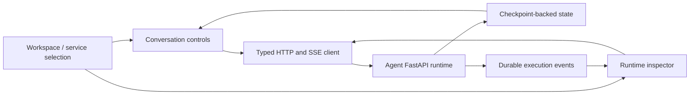

# Studio Architecture

## Responsibility and status

Studio is the development and runtime-inspection UI for Agent. Sessions, chat,
run controls, interrupt/resume, recovery acknowledgement, execution events,
saved state, and checkpoint comparison are implemented.

It is separate from the planned Knowledge Dashboard and user-facing Chat bubble.
Attachments, editable checkpoint branches, a research-artifact viewer, and
per-token streaming are not implemented.

## Client and backend flow

React renders views while the workspace coordinates selected service, session,
run, and loaded data. The runtime client handles transport. The backend owns
execution, run status, conversation state, and persistence.

Conversation rendering lives in `components/runtime/conversation.tsx`, with
Markdown helpers under `components/thread/`. UI controls and the runtime
inspector share the selected session and run; they do not maintain a second
server-side conversation store.

## Continuity and observation

The selected session remains stable across turns. Each submission carries an
idempotency key. Durable events update execution views over SSE with reconnect
and duplicate suppression. Saved checkpoint state supplies messages; events
are observations rather than a replacement conversation archive.

The inspector's hierarchy represents observed execution spans. It is not a
graph-topology editor or an external tracing service. Failed or unfinished
execution requires replay acknowledgement; interruptions accept resume values.

## Deployment boundary

Studio is a browser client built by Vite. Development uses port 5173 with hot
reload; preview uses port 3000. Built assets can be served by Agent using
`APP_STATIC_DIRECTORY`. No separate Node application backend is required.

Browser storage remembers service and session selection. Credentials and model
configuration belong to the backend. Cross-origin use requires compatible CORS;
authenticated remote operation is not implemented.

See [integration and commands](backend.md), [Agent architecture](../agent/architecture.md),
and [Chat architecture](../chat/architecture.md).
